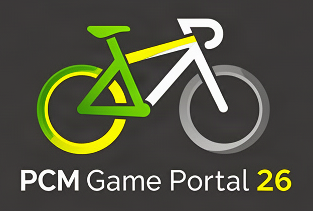

  

  <b>The free companion tool for Pro Cycling Manager 26.</b> 
  Load your career savegame, analyse teams and riders, plan your season – and save your changes straight back into the game.

  <a href="https://github.com/KONTO/REPOSITORY/releases/latest/download/PCMGamePortal26_Setup.exe"><b>⬇ Download</b></a> ·
  <a href="WEBSITE-URL">Website</a> ·
  <a href="https://www.instagram.com/pcmgameportal/">Instagram</a> ·
  <a href="https://ko-fi.com/pcmgameportal">Support on Ko-fi</a>

  
  
  
  

---

> [!WARNING]
> PCM Game Portal is in **alpha**. Things may still change or break. Keep your own copy of important savegames before editing them.

## Features

### Overview & analysis
- **Home page** – savegame, game date, your team, account balance, team ranking and season wins at a glance.
- **Teams, riders, races, countries** – detail pages with results, stage profiles, history, achievements, photos and jerseys.
- **Rankings & calendar** – rider, team and nation rankings plus the full race calendar.
- **Squad analysis** – compare your squad with your rivals by rider type, this season and next.
- **Rider development** – history of all abilities, spider chart, season races and greatest career results.
- **Finances & sponsors** – account balance, budget planning, sponsor money and sponsor season goals.

### Planning
- **Planning assistant** – set leaders, assign Grand Tours, classics and World Tour races, build start lists.
- **Team planner** – line-ups per race via drag & drop, with hints on overlaps and race days.
- **Training plan** – change fitness target weeks of your riders, with form preview and injury history.
- **Plan all teams** – plans the season of all AI teams automatically using the same rules.

### Edit your savegame
- **Contracts** – adjust the contract end of riders and staff.
- **Transfers** – move a rider to another team, with contract length.
- **Roles** – change roles one by one or assign them automatically for all teams.
- **New rider** – create your own riders with rider type and potential.
- **Team switch** – take over another team at any time.
- **More tools** – dossier points, reset fatigue, yearly form and sponsor figures.

### Dynamic world
- **Dynamic potential** – once per season rider potentials rise or fall, for realistic careers.
- **Dynamic national teams** – the strongest nations get national teams for the matching races.
- **Country swap** – swap countries; missing national jerseys are created automatically as a mod package for the game.

### Safety & comfort
- **Change overview** – before saving you see a short summary of what was changed.
- **Restore** – the last save can be undone from the start screen.
- **Three languages & mods** – English, German and French, also with workshop mods such as World DB.
- **Update notice** – the app tells you when a new version is available.

## Requirements

| | |
|---|---|
| **System** | Windows 10 or 11 (64-bit) |
| **.NET** | Included – nothing extra to install |
| **Disk space** | approx. 400 MB |
| **Game** | Pro Cycling Manager 26 (Steam) |
| **Savegame** | A career savegame |
| **Optional** | Workshop mods such as World DB |

## Installation

1. Download **[PCMGamePortal26_Setup.exe](https://github.com/KONTO/REPOSITORY/releases/latest/download/PCMGamePortal26_Setup.exe)** from the latest release.
2. Run the setup. It installs to `C:\Program Files\PCM Game Portal 26` and asks once for administrator rights.
3. Start **PCM Game Portal 26** from the Start menu and load your career savegame.

> [!NOTE]
> The setup is not code-signed. Windows SmartScreen may show *"Windows protected your PC"*. Click **More info → Run anyway** to continue.

### Updating
Download the newest setup and run it – it replaces the old version. Your settings are kept.

### Uninstalling
*Settings → Apps → Installed apps → PCM Game Portal 26 → Uninstall.*

## How it works

1. Close Pro Cycling Manager 26.
2. Open PCM Game Portal and load your career savegame.
3. Analyse, plan and edit.
4. Click **Save savegame** – your changes are written back into the savegame, and a backup of the previous state is kept.
5. Start the game and continue your career.

## Feedback & bugs

Found a bug or have an idea? Open an [issue](https://github.com/KONTO/REPOSITORY/issues) or write to **pcmgameportal [at] protonmail [dot] com**.
Please include the app version (bottom left in the app) and, if possible, the steps to reproduce the problem.

## Support the project

PCM Game Portal is free in full – no paid features, no ads.
If you like it, you can support the development on **[Ko-fi](https://ko-fi.com/pcmgameportal)** and follow the project on **[Instagram](https://www.instagram.com/pcmgameportal/)**.

## License

PCM Game Portal is freeware: free to download and use. All rights reserved.
This repository only hosts the setup file – the source code is not published.
Third-party components included in the installation keep their own licenses.

## Disclaimer

PCM Game Portal is an unofficial fan tool. It is not affiliated with, endorsed by or connected to Cyanide or Nacon.
"Pro Cycling Manager" is a trademark of its respective owners.
Use at your own risk – always keep a copy of savegames you care about.
